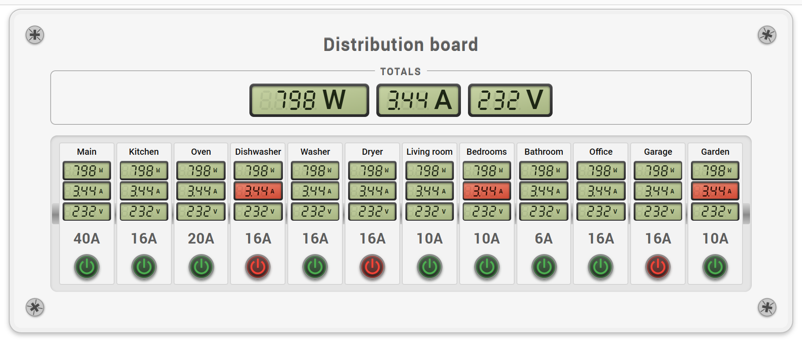
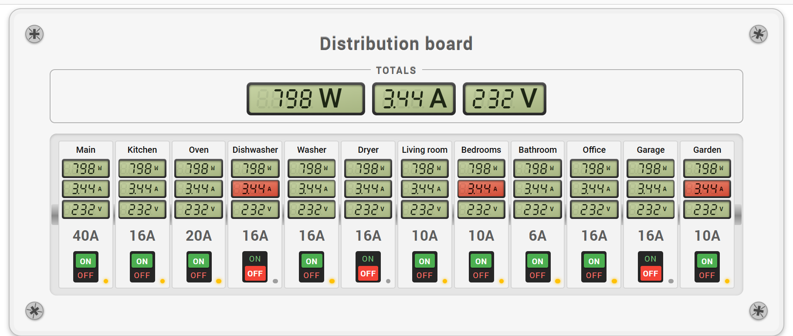

# DIN Rail Cards

Two Lovelace cards that show switches as DIN rail equipment:

- **DIN rail switch** (`custom:din-rail-switch-card`): one breaker with power,
  current and voltage. It can also show them on retro LCD displays.
- **DIN rail panel** (`custom:din-rail-panel-card`): a distribution board with
  up to 3 rails of 12 modules.

Both cards have a visual editor.

A distribution board with stand-by buttons (`switch_style: button`):



The same board with DIN rail levers (`switch_style: din`):



## Project agenda

I needed a distribution board panel like the one I tried to write myself
three years ago, but I had no time. So Claude developed this panel 100%,
with me as the mentor.

It fulfills my use case 100%. If you need something more, I'm not promising
to add it, but I'll try: ideas from others are always welcome. And you can
do the same as I did.

## Installation

### HACS

1. In HACS, open **⋮ → Custom repositories**, add
   `https://github.com/max-lyulchenko/din-rail-cards` with the type
   **Dashboard**, and close the dialog.
2. Search for **DIN Rail Cards** in HACS, open it and click **Download**.
3. Reload the browser (Ctrl+F5). HACS adds the resource itself.

### Manual

1. Download `din-rail-cards.js` from the
   [latest release](https://github.com/max-lyulchenko/din-rail-cards/releases/latest)
   and copy it to `<config>/www/community/din-rail-cards/`.
2. Go to **Settings → Dashboards → ⋮ → Resources → Add resource**
   (no Resources item? Turn on **Advanced mode** in your user profile):
   - URL: `/local/community/din-rail-cards/din-rail-cards.js?v=1`
   - Type: **JavaScript module**
3. Reload the browser. After each update, raise `?v=` so the browser loads
   the new file.

## Configuration

```yaml
type: custom:din-rail-switch-card
entity: switch.main_breaker
power_entity: sensor.main_power
current_entity: sensor.main_current
voltage_entity: sensor.main_voltage
switch_style: din # din (vertical lever) or button (stand-by button)
lcd_displays: true # retro LCD displays
show_power: true # each reading can be hidden: show_power, show_current, show_voltage
precision: 1 # 0-2 decimals on the LCD displays
rating_entity: number.main_breaker_over_current_threshold # optional, see below
max_current: 40 # optional: the current turns red above it (the rating by default)
```

```yaml
type: custom:din-rail-panel-card
title: Distribution board # engraved in the cover
title_color: red # optional: a theme color (red, primary) or a CSS color (#c62828)
columns: 12 # modules per rail, 1-12
switch_style: din # the same for all modules
panel_theme: white # white, or black (light text on black)
show_voltage: false # hide a reading on all modules (show_power, show_current too); the totals have their own switches
zoom_on_hover: true # magnification: a larger copy of the module (its name over the switch) or the totals under the mouse
precision: 0 # 0-2 decimals of the modules and the totals (W, A)
show_totals: true # W (4 digits, kW above 9999 W), A (3 digits), V (3 digits); a sensor shared by modules counts once
show_total_voltage: true # each total on its own: show_total_power, show_total_current, show_total_voltage
# Optional: show these sensors (a main meter, say) instead of the totals of the modules
total_power_entity: sensor.main_power
total_current_entity: sensor.main_current
total_voltage_entity: sensor.main_voltage
modules:
  - entity: switch.kitchen
    name: Kitchen
    power_entity: sensor.kitchen_power
    current_entity: sensor.kitchen_current
    voltage_entity: sensor.kitchen_voltage
    rating_entity: number.kitchen_over_current_threshold # optional, see below
    max_current: 16 # the current display turns red above it (the rating by default)
```

In the visual editor, a breaker (the switch card, or a module of the panel)
can have a **Device**. Its switch, sensor and rating pickers then offer only
the entities of that device. The editor saves it as `device` (a device id);
the cards do not use it.

A breaker shows its rating above the switch, like the print on a real one:
the value in A of `rating_entity` (a number, input_number or sensor entity).
Without it, the card uses a number entity of the switch's device ending in
`_over_current_threshold`, or else `number.<switch>_over_current_threshold`
(`number.kitchen_over_current_threshold` for `switch.kitchen`), when there is
one. The rating is the max current unless `max_current` is set.

When the sensors are left out, the cards look for power, current and voltage
sensors on the device of the switch.

## Test kit

[TEST-KIT.md](TEST-KIT.md) explains how to try the cards without real
breakers: 12 simulated breakers with load and voltage sliders, and a dashboard
with every card variant. `npm run test-kit` builds it.

## Development

You need Node.js 24.

```sh
npm install         # once, and after dependencies change
npm run build       # dist/din-rail-cards.js
npm run watch       # rebuild on every change
npm test            # unit tests
npm run lint        # formatting and types
npm run format      # format the code
```

To try a change, copy `dist/din-rail-cards.js` to
`<config>/www/community/din-rail-cards/` and raise `?v=` in the resource URL.

### In the demo of the Home Assistant frontend

The demo of a [Home Assistant frontend](https://github.com/home-assistant/frontend)
checkout can load the cards from this project, with simulated breakers and a
distribution board. Its development build needs this resource, which a fork
of the frontend adds in `demo/src/stubs/lovelace.ts`:

```ts
{ id: "din-rail-cards", type: "module", url: "http://localhost:5050/din-rail-cards.js" }
```

1. Here: `npm run dev` builds the cards on every change and serves them at
   `http://localhost:5050/din-rail-cards.js`.
2. In the frontend: start the demo (`gulp develop-demo`) and open
   `http://localhost:8090`. The console shows `DIN-RAIL-CARDS 0.1.0-dev`
   when the cards are loaded.
3. After a change, reload the demo page.

| Path                       | What it is                                        |
| -------------------------- | ------------------------------------------------- |
| `src/index.ts`             | Entry point: registers the cards                  |
| `src/cards/`               | The cards and their config types                  |
| `src/editors/`             | Their visual editors                              |
| `src/components/`          | The stand-by button and the seven-segment display |
| `src/format-lcd-value.ts`  | LCD formatting, voltage and current limits        |
| `src/ha.ts`                | What the cards use of Home Assistant              |
| `src/translations/en.json` | Texts                                             |
| `scripts/`                 | Build and test kit                                |

### Releases

Versions follow Home Assistant: `YEAR.MONTH.PATCH`, like `2026.11.0`.
The first release of a month has patch 0, and each later release that month
raises it (`2026.11.1`, `2026.11.2`). The month has no leading zero
(`2027.1.0`). Releases up to 0.5.1 used `0.x.y`.

1. Set `version` in `package.json` and commit.
2. On GitHub, create a release with the version as its tag and its title,
   without a prefix (`2026.11.0`). The release workflow builds
   `din-rail-cards.js` and attaches it to the release, which is where HACS
   downloads it from.

## License

Apache License 2.0, see [LICENSE](LICENSE). The cards contain code adapted
from the [Home Assistant frontend](https://github.com/home-assistant/frontend),
see [NOTICE](NOTICE).
